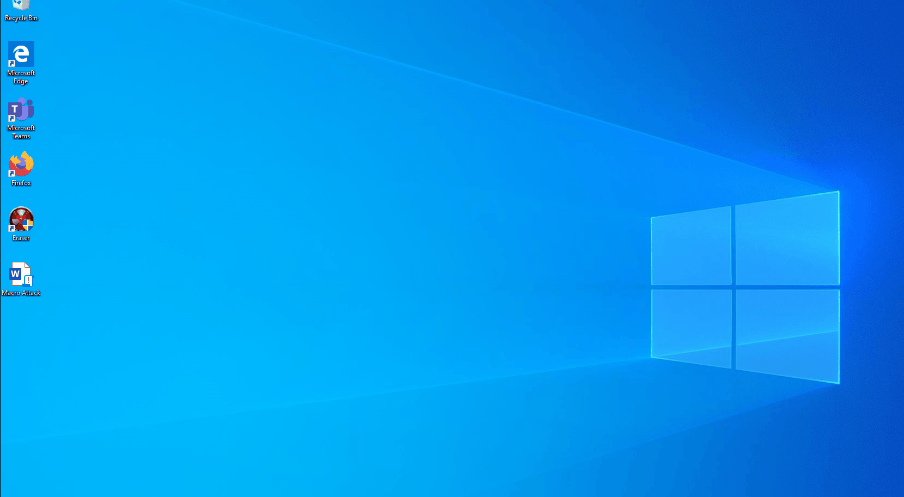

# Attachments: Macros

Macros, a set of automated instructions, serve as a scripting language that allows adversaries to automate various attacks. In Windows versions from 2007 onwards, users can bundle frequently performed tasks into a macro for streamlined execution.

For red teamers, macros provide a means to execute code or commands, leveraging the legitimacy of MS Office to evade antivirus detection. However, modern antivirus solutions are becoming more adept at identifying such malicious activities. To circumvent detection, obfuscation techniques can be applied to the file. Macros can execute code, such as Visual Basic (VB).

An illustrative example involves utilizing tools like the Unicorn tool by Dave Kennedy at TrustedSec and a basic PowerShell Reverse Shell. Combining these tools allows the creation of a Macro Payload, enabling unauthorized access to the target machine upon execution on the victim's system.

Unicorn Menu

<figure><figcaption></figcaption></figure>

From the range of payloads provided by Unicorn, I will opt for the Custom PS1 Attack Example, incorporating the Macro component. This seamless integration allows for the creation of a Macro tailored to execute the desired PowerShell script, streamlining the process of initiating the attack.

<figure><figcaption></figcaption></figure>

 

A novel file, named powershell\_attack.txt, will be generated. Upon inspecting this file, the embedded VBA Code will be revealed, ready to be copied and pasted into our Word Document.

<figure><figcaption></figcaption></figure>

We transition to our sample machine running Windows and initiate the creation of a new Word Document.

To activate this feature, we navigate to the Options Menu, proceed to the Customize Ribbon section, and opt for the Developer Options. From there, we can start crafting a macro.

<figure><figcaption></figcaption></figure>

Create a New macro and Name it Auto\_Open

\
.png>)

In the subsequent window, we copy the entire code from our "powershell\_attack.txt" file and save it.

<figure><figcaption></figcaption></figure>

Proceed to save the file, ensuring to select the "Macro-Enabled Document" format. This file is what needs to be attached and sent to our target.

<figure><figcaption></figcaption></figure>

At this point, we will return to our attacking machine, initiate the listener, and patiently wait for a shell connection back to our system. Upon opening the document, the user may encounter an Application Error. This behavior is intentional and designed to create the impression that the document is intended for "older" versions of the file.

<figure><figcaption></figcaption></figure>
