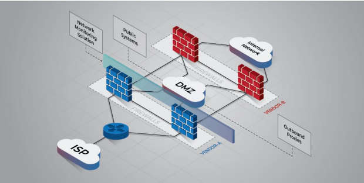

# 2.1 Install Perimeter and Internal Defense Devices

To fortify a network, it is crucial to deploy a crack-proof defensive strategy that safeguards individual components and the data they hold. At the network perimeter, multiple layers of defense should be in place to counter external threats and effectively monitor and control inbound and outbound traffic.

The following are some recommendations from DISA that follow the measures for configuring and installing security devices at the network perimeter:

* Utilize a border router to establish a connection to the external network, such as an Internet Service Provider (ISP).
* Employ multiple layers of Next-Generation Firewalls (NGFWs) across the network to regulate inbound and outbound traffic, as well as scrutinize internal activities between different network segments. Using different vendors for each layer can mitigate risks associated with adversaries exploiting the same, or common vulnerabilities to breach the internal network. It also eliminates single point of failure.
* Integrate a network monitoring solution, such as Paessler's PRTG, or such as a Network Intrusion Detection System (NIDS), a traffic inspector, such as Nagios, or a full-packet capture device, such a Wireshark, to log and track inbound and outbound traffic.
* Deploy redundant devices in core areas to ensure availability, which can then be load-balanced to enhance network throughput and reduce latency and bottlenecks.

<figure><figcaption>
<em>Figure 1: Network perimeter with firewalls and a DMZ</em>
</figcaption></figure>

* Deploy multiple dedicated remote log servers to enable activity correlation among devices and detection of lateral movement.
